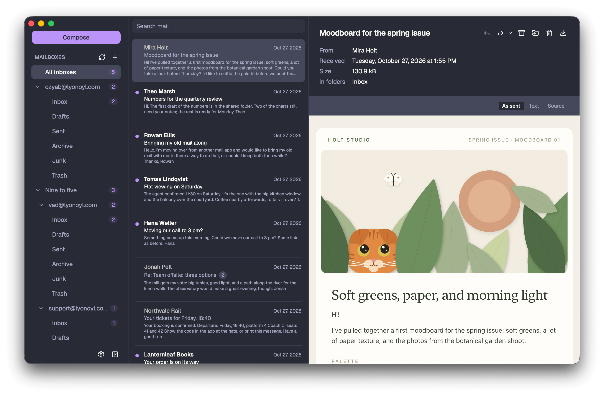
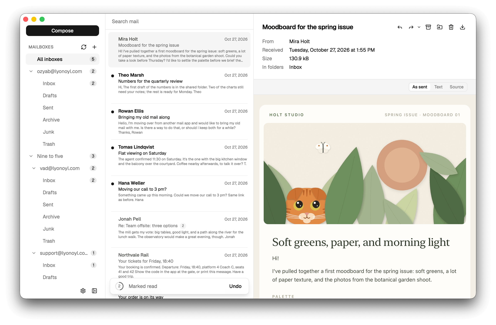

<div align="center">


# Lyonoyl Mail

**The email client that respects your privacy**

[](https://www.rust-lang.org/)


[](LICENSE)

</div>

A modern, open-source desktop email client built with Rust, designed for privacy, performance, and simplicity.





**11 themes:** six dark and five light

**Available languages:** 🇸🇦 🇧🇩 🇨🇳 🇺🇸 🇫🇷 🇩🇪 🇮🇳 🇮🇩 🇯🇵 🇰🇷 🇧🇷 🇷🇺 🇪🇸 🇹🇭 🇹🇷 🇵🇰 🇻🇳 

## What it protects you from

Mail is the one thing on your computer that strangers send files to every day, without asking.

- **No message runs code.** Lyonoyl Mail cleans every message before you see it and shows it in a frame that runs nothing and reaches nothing.
- **Trackers wait for your yes.** Pictures from the web load only when you ask, and Lyonoyl Mail never sends a read receipt.
- **No link can pretend.** Before a link opens, you see the real address behind it.
- **Attachments never open themselves.** Lyonoyl Mail saves a file a message carries and never runs it.
- **Your passwords stay locked away**, in your system's keychain or behind a master password, never in your mail's files.
- **Lyonoyl Mail encrypts your mail**, so a stolen disk cannot reveal it.
- **Your computer stays unnamed.** Mail you send never names your computer or its system.
- **Nothing phones home.** No telemetry, no analytics, and no update check unless you agree to one.

How each of these works is in [the threat model](docs/security/threat-model.md). Behind them stands layer upon layer of [defenses](docs/security/defenses.md) against everything from a hostile message to a forged update, each with a check that fails without it, and no change lands until every check passes.

## Sponsors

Your logo and a link to your product can stand here. Be the cat's patron: [patron@lyonoyl.com](mailto:patron@lyonoyl.com)

<a href="mailto:patron@lyonoyl.com?subject=Sponsoring%20Lyonoyl%20Mail"></a>

## Install and build

### Install

Download Lyonoyl Mail from [the latest release](https://github.com/lyonoyl/lyonoyl/releases/latest).

### Build

Lyonoyl Mail builds from source. The [documentation](docs/development/guide.md#what-a-build-needs) lists what each system needs.

```bash
git clone https://github.com/lyonoyl/lyonoyl.git
cd lyonoyl
npm install
npm run app:build
```

## Documentation

| Document | What is in it |
| --- | --- |
| [Architecture](docs/architecture/overview.md) | How the code is put together, and why |
| [Data model](docs/architecture/data-model.md) | The tables your mail is kept in, and how much room they take |
| [Defenses](docs/security/defenses.md) | Every defense Lyonoyl Mail has, and the test or check that holds it |
| [Development](docs/development/guide.md) | How to run, test and build Lyonoyl Mail with a mail server for development |
| [Platforms](docs/platforms/differences.md) | Where macOS, Windows and Linux differ, and what the code does about it |
| [Privacy](PRIVACY.md) | What reaches the project from your copy, and what its site keeps |
| [Response budgets](docs/performance/response-budgets.md) | How long each action may take, and what was measured |
| [Review checklists](docs/review-checklists/README.md) | What a review checks in mail handling, security, architecture and responsiveness |
| [Threat model](docs/security/threat-model.md) | What Lyonoyl Mail trusts, what it does not, and how each defense works |

## Contributing

Pull requests are welcome: [the contributing guide](CONTRIBUTING.md) says what one needs, and taking part means keeping to [the code of conduct](CODE_OF_CONDUCT.md). The [working contract](AGENTS.md) describes where code goes, what must never break, and the recipe for adding a feature end to end. The [development guide](docs/development/guide.md) explains how to run, test and build Lyonoyl Mail, and the checks to pass before opening a pull request.

## Security

Found a vulnerability? Report it privately, the way the [security policy](SECURITY.md) describes, rather than in a public issue. An idea that would make Lyonoyl Mail safer is an issue, opened as [getting help](SUPPORT.md) describes.

## Donations

Every donation keeps the cat fed. The [donation page](docs/donations/README.md) lists the ways to give.

<a href="docs/donations/README.md"></a>

## License

[Apache-2.0](LICENSE)
