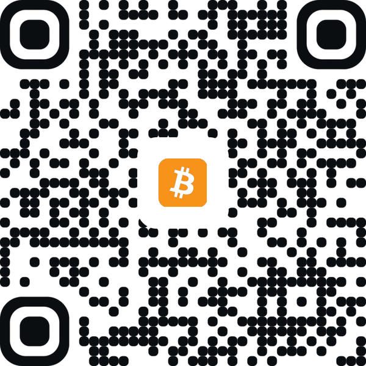
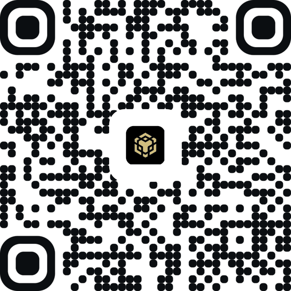
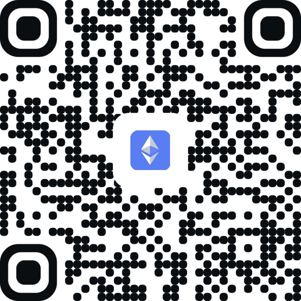
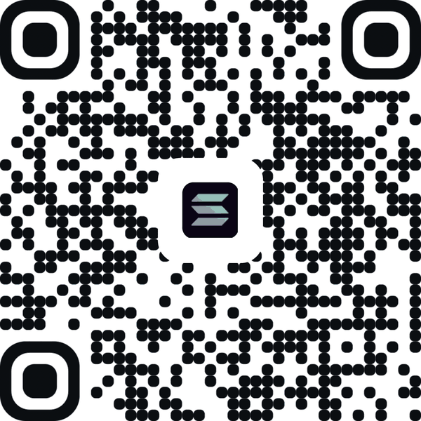
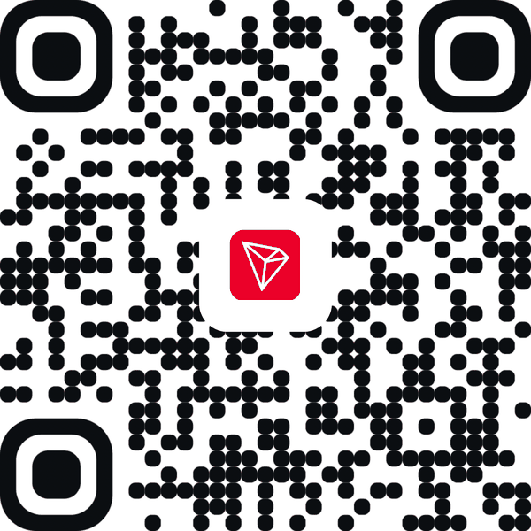

# Support the Project

Every donation keeps the cat fed, and a well-fed cat hunts bugs. It is a gift rather than a purchase: it buys no product, support, or say in what Lyonoyl Mail does, and it is not tax-deductible—all it brings back is a grateful purr.

## GitHub Sponsors

Feed the cat every month or just once on [GitHub Sponsors](https://github.com/sponsors/lyonoyl), at any level from Lil' Chomp to Supreme Cat Overlord. The maintainers see who sponsors, and a public sponsorship shows it to everyone.

## Crypto

Every address below is a wallet made for Lyonoyl Mail alone, so each coin lands straight in the cat's bowl. A payment on these networks is public—anybody can see the address it came from—and once sent, it cannot be returned.

<table>
<tr><th>Network</th><th>Address</th><th>QR code</th></tr>
<tr><td>Arbitrum</td><td>

```
0x66BD1659Ae2C6B9f93416bfC07802722b0eF15e6
```

</td><td></td></tr>
<tr><td>Bitcoin</td><td>

```
bc1q0rs2tslpxul685u5rl6rfd2gwgm70cnmmh49se
```

</td><td></td></tr>
<tr><td>BNB Smart Chain</td><td>

```
0x66BD1659Ae2C6B9f93416bfC07802722b0eF15e6
```

</td><td></td></tr>
<tr><td>Ethereum</td><td>

```
0x66BD1659Ae2C6B9f93416bfC07802722b0eF15e6
```

</td><td></td></tr>
<tr><td>Solana</td><td>

```
5Amo8ZCyQxm9ChevhJkYvhG8EG22gT1tTytDscMYAEXF
```

</td><td></td></tr>
<tr><td>Tron</td><td>

```
TU4WBVmz87tBd1ydwuj2T44NVMmimvzw6q
```

</td><td></td></tr>
</table>
