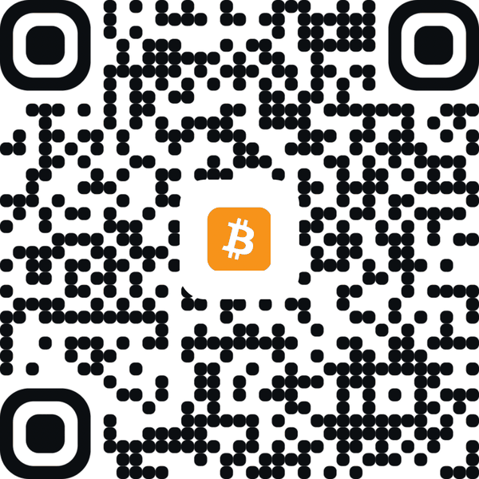
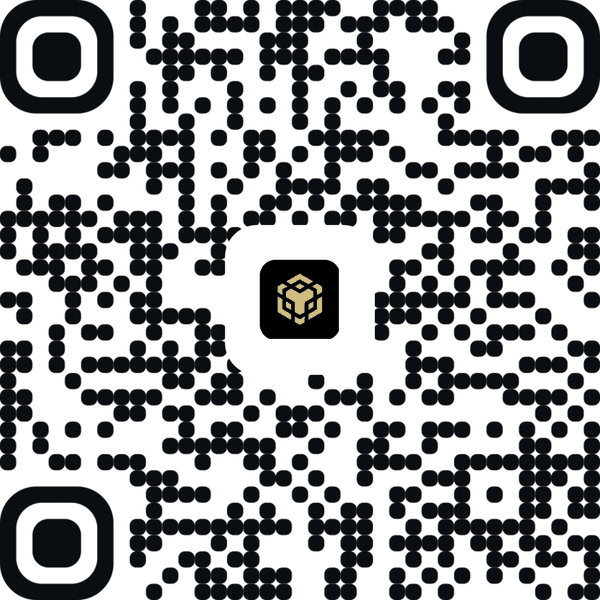
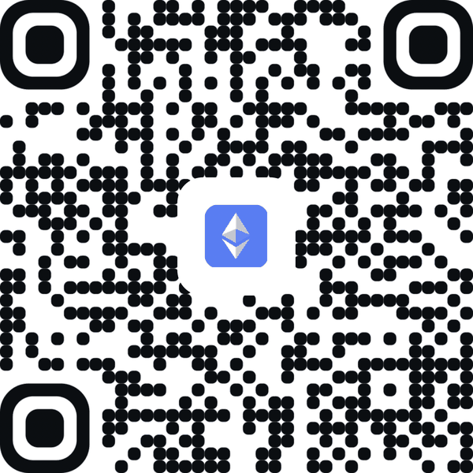
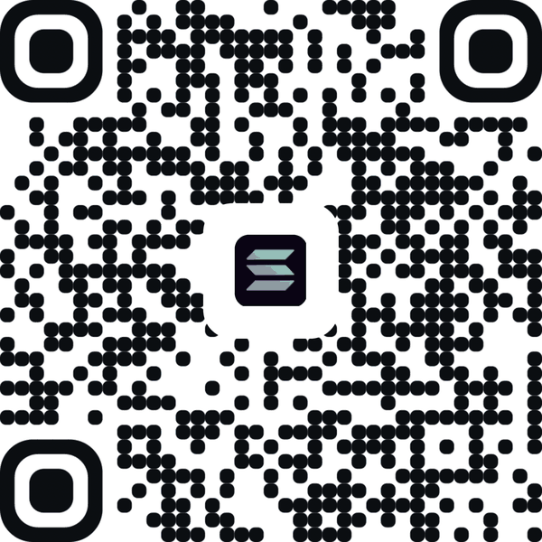
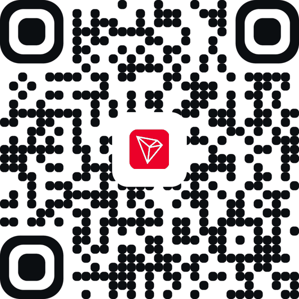

# Donations

Every address on this page is a wallet made for Lyonoyl Mail alone.

A donation is a gift to the project: it buys no product, support, or say in what Lyonoyl Mail does, is not tax-deductible, and cannot be returned. A payment on these networks is public, and anybody can see the address it came from.

## Crypto

<table>
<tr><th>Network</th><th>Address</th><th>QR code</th></tr>
<tr><td>Arbitrum</td><td>

```
0x66BD1659Ae2C6B9f93416bfC07802722b0eF15e6
```

</td><td></td></tr>
<tr><td>Bitcoin</td><td>

```
bc1q0rs2tslpxul685u5rl6rfd2gwgm70cnmmh49se
```

</td><td></td></tr>
<tr><td>BNB Smart Chain</td><td>

```
0x66BD1659Ae2C6B9f93416bfC07802722b0eF15e6
```

</td><td></td></tr>
<tr><td>Ethereum</td><td>

```
0x66BD1659Ae2C6B9f93416bfC07802722b0eF15e6
```

</td><td></td></tr>
<tr><td>Solana</td><td>

```
5Amo8ZCyQxm9ChevhJkYvhG8EG22gT1tTytDscMYAEXF
```

</td><td></td></tr>
<tr><td>Tron</td><td>

```
TU4WBVmz87tBd1ydwuj2T44NVMmimvzw6q
```

</td><td></td></tr>
</table>
